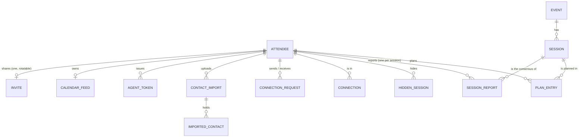
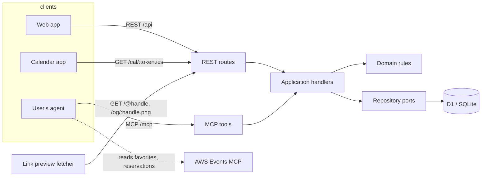
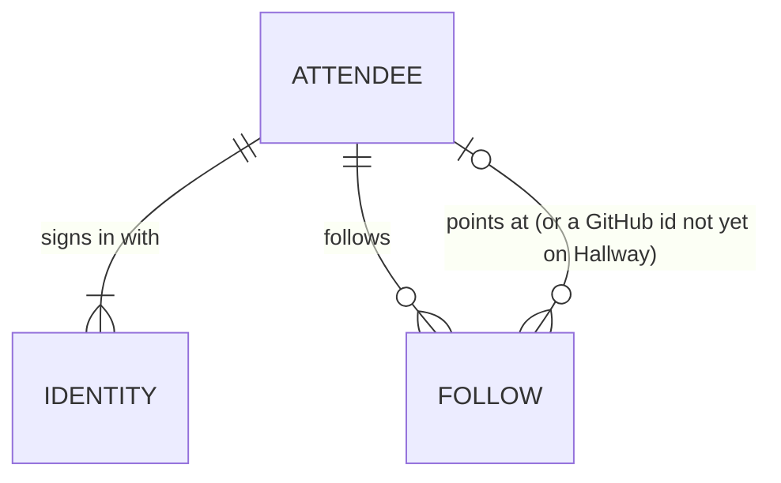

# Domain: Hallway

Hallway shows you where the people you know will be at AWS re:Invent 2026
(Las Vegas, 30 Nov to 4 Dec 2026), and lets your agent plan around them.

Written 2026-11-13, before any code, from the owner's brief and the research in
`docs/discovery/aws-events-api.md` and `docs/discovery/linkedin.md`. This file is
the model the code must match; when the code needs something different, change
this file in the same PR.

## What people need to do

1. **Get my re:Invent schedule in without retyping it.** My agent already talks
   to the AWS Events MCP server, which knows my favorites and reservations. I
   tell it "put my schedule on Hallway" and it does.
2. **See where my people will be.** Open a colleague's page and see their week;
   open a session and see which of my connections are going.
3. **Let my agent plan with my network.** "I'm free Tuesday afternoon, what are
   my connections going to?" "Find a gap where I can meet Priya."
4. **Show off my week.** Post a picture of my schedule on LinkedIn with a link
   that opens the live page, and subscribe to it in my calendar.
5. **Click through to the real thing.** Every session links to its page on the
   re:Invent site, where reserving happens. Hallway never reserves.
6. **Control who sees it.** Public, my network only (connections and the people I follow), or private; hide any
   single session.

## Constraints the research fixed

- **We cannot read anyone's AWS schedule ourselves.** The AWS Events API's only
  OAuth client is public and accepts loopback callbacks on fixed ports, so a web
  app cannot sign people in to it. The attendee's own agent reads AWS and writes
  to us. That is the whole import path, and it is a feature: the agent is the
  user's, the token is the user's, we hold nothing of AWS's.
- **The catalog is behind registration**, so we cannot crawl it. Hallway's
  session catalog is built from the sessions attendees' agents send: each
  snapshot is that attendee's report, and the catalog shows what the reporters
  agree on (rule below, ADR 0016). We keep every field an agent sends of a
  session but AWS's live seat state, and **show the abstract only to an
  attendee whose own agent sent one that another attendee's agent
  corroborates**: it is AWS's content behind a login (ADR 0025, amending
  0003; tightened by #83).
- **LinkedIn will not give us anyone's connections.** Sign In with LinkedIn
  (OpenID Connect) gives a verified identity: `sub`, name, picture, email. The
  Connections API is partner-only and closed. So the network is Hallway's own
  (connect requests), seeded from the user's LinkedIn data export
  (`Connections.csv`) and from share links.

## Resources

Each resource is what the REST API exposes and what the MCP tools speak. The
front end knows these shapes and nothing else.

| Resource | What it is | Key fields |
| --- | --- | --- |
| **Attendee** | A person on Hallway | `id`, `handle` (share URL `/@handle`; reserved words such as `api`, `settings`, `dev` are refused, `isReservedHandle`), `handlePlaceholder` (private, in `Me` only: the handle is a made-up `attendee-` one, rule below), `displayName`, `headline`, `avatarUrl`, `linkedinProfileUrl` (claimed, unverified), `visibility` (`public` \| `network` \| `private`, default `network`; `network` was `connections` before #63). Private: `verifiedName` (the first identity's name, not editable), `email` (the first identity's, stored only when that provider says it is verified). Signs in through one or more Identities (below) |
| **Event** | re:Invent 2026, as AWS describes it | `eventId` (`reinvent2026`), `name`, `timezone` (`America/Los_Angeles`), `startDate`, `endDate`. Seeded, not user-created |
| **Session** | One session as the catalog shows it: per field, what most of its reporters agree on | `sessionId` (AWS's), `eventId`, `code` (AWS `abbreviation`, e.g. `AIM3315`), `title`, `type`, `level`, `venue`, `room`, `startsAt`/`endsAt` (UTC instants, derived from AWS's local date, time, length and the event timezone), `isAllDay`, `speakers[]` (names), the lists `tracks[]`, `topics[]`, `industries[]`, `areasOfInterest[]`, `roles[]`, `services[]`, `segments[]`, `features[]`, `customerPersonas[]`, `experiences[]`, `additionalActivities[]`, `focusAreas[]`, `url` (derived, see below), `lastSeenAt` (the newest report). `abstract` (AWS's plain text) only on search and get, and only to a reader `canReadAbstract` allows (rule below). Never `seatAvailability` or `isReservable` |
| **Session report** | Not served: one attendee's account of one session, their agent's snapshots of it merged forward | the session's fields and its abstract, `attendeeId`, `reportedAt`, and (stored only) `abstractKey`, the SHA-256 of the abstract's normalized text, which corroboration compares. One per attendee and session |
| **Plan entry** | One session on one attendee's schedule | `attendeeId`, `sessionId`, `intent` (`interested` = AWS favorite, `reserved` = AWS reservation or invitation), `source` (`agent-sync` \| `manual`), `invited` (bool: from AWS `invitedSessions`), `hidden` (bool, from the hidden sessions below), `addedAt` |
| **Hidden session** | Not served on its own: a session an attendee hid, per event | `attendeeId`, `eventId`, `sessionId`. An entry is hidden while its session is here |
| **Connection** | Two attendees who agreed to see each other | unordered pair, `since`, `via` (`request` \| `share-link`) |
| **Connection request** | One attendee asking another | `from`, `to`, `status` (`pending` \| `accepted` \| `declined` \| `withdrawn`), `createdAt` |
| **Contact import** | One upload of the user's LinkedIn `Connections.csv` | `id`, `attendeeId`, `importedAt`, `count` |
| **Imported contact** | One row of it, reduced | normalized LinkedIn profile URL, SHA-256 of a lowercased email when present, normalized full name. **No other columns are kept** (company, position and the raw email are dropped at parse) |
| **Suggestion** | Derived, not stored: an attendee who matches one of my imported contacts and is not yet connected | `attendee`, `reason` |
| **Agent token** | A personal token an agent uses for MCP and REST | `id`, `label`, `prefix` (shown), hash (stored), `createdAt`, `lastUsedAt`, `revokedAt`. Secret shown once |
| **Calendar feed** | A secret iCalendar URL of my visible schedule | `token` (rotatable; stored readable so its owner can see the link again, unlike every other secret; shown only to its owner signed in as a person, never in a public resource). One per attendee |
| **Invite** | The secret in my share link, `/@handle?invite=<token>`: whoever opens it may connect to me at once | `token` (32 random bytes, base64url; made on first ask, rotatable; stored readable like the calendar feed so its owner can copy the link again; shown only to its owner signed in as a person, never in a public resource or a log), `rotatedAt`. One per attendee |

### Session link

`url` is not stored: the contract resource derives it from `code` with `sessionUrl(code, template)` and one configured template,
`SESSION_URL_TEMPLATE`. The default is the re:Invent catalog searched for the
code. **Assumption** (no public deep-link format was found): the template is one
config value precisely so that it can change without a migration. See issue
"Confirm the session deep-link format".

### Times

AWS gives a session's local `date`, `time` and `length` in the event timezone.
We store UTC instants and the event timezone, and render in the event timezone
(Las Vegas time), always, because that is the time on the badge.

## Rules (the domain holds these)

- **Visibility.** Who may see an attendee's schedule:
  - `public`: anyone with the link, signed in or not.
  - `network` ("My network"; `connections` before #63, ADR 0019): the
    attendee, their connections, and the people they follow (GitHub, or found
    in their own LinkedIn import). **Following someone never lets you see
    their schedule; their following you does.** The owner's act (connecting,
    following, importing) is the consent; nobody else's.
  - `private`: the attendee only.
  - A `hidden` plan entry is never shown to anyone but its owner, and never
    counted in "who is going" or in a connection's session counts, nor lends
    its owner an intent there.
  - **Hiding is a preference, not a property of an entry.** The attendee's
    hidden sessions are kept per event apart from the entries; an entry is
    hidden while its session is in that set. A session that leaves a sync and
    comes back is still hidden; only showing it again takes it out (#53, hunt
    F5).
  - One function decides this (`canViewSchedule(viewer, owner, tie)`, with
    `visibleEntries` for the entries), and every read path (REST, MCP,
    calendar feed, share image, link preview) goes through it. `tie` is how
    the viewer stands to the owner, `{ connected, followedByOwner }`; whether
    the viewer follows the owner is not in it, because it never counts. Every
    path gets it from one lookup, `tieBetween` (the network repository's
    `tie`, wired once in `apps/api/src/index.ts`), or for a bulk read the
    same tie read from the same tables beside the plans (`networkPlans`).
  - What leaves Hallway (calendar feed, share image, link preview) goes
    through `shareableEntries`: the visible entries, minus hidden ones even
    when the viewer is the owner, who is about to show it to others. A link
    preview is always the anonymous view, since everyone a link is posted to
    sees the card (ADR 0012).
- **A handle is ASCII, made from the name.** It is a link people paste into
  LinkedIn posts, where a percent-encoded URL reads as broken. On first
  sign-in `handleFromName` folds Latin Extended letters to base letters
  (NFKD, marks stripped, and a small table: Ł→l, Ø→o, Đ→d, ß→ss, Æ→ae, Œ→oe,
  Þ→th). A name that leaves no Latin letter (Cyrillic, Greek, CJK and so on)
  gets `attendee-` and four random letters or digits (`placeholderHandle`),
  never a count, which would say how many people have signed up, and is
  marked `handlePlaceholder`. The web asks that person to choose a handle on
  each visit until they do, and the share sheet nudges them; changing the
  handle clears the mark. A handle never changes by itself. Decided on #48.
- **Sync replaces, never duplicates.** `SyncSchedule` for an event makes the
  attendee's `agent-sync` entries exactly equal to the sent favorites,
  reservations and invited sessions: new ones added, missing ones removed,
  `reserved` beats `interested` when a session is in both, and an invited
  session is `reserved` and marked `invited` (`syncedSessions`). `manual`
  entries and hidden sessions survive a sync.
- **A manual entry keeps the attendee's own intent.** A sync never removes a
  `manual` entry. Its intent is `reserved` while the latest sync reports the
  session reserved (or invited), and otherwise the attendee's own intent,
  which is `interested`, the only one `AddToPlan` gives (`manualAfterSync`). So
  a reservation cancelled on AWS lowers it back on the next sync; it keeps
  `source: manual`. Replaces #24's "never lowers" (#53, hunt F7).
- **A sync is a replace even when two run at once.** The write is computed
  from what the sync sent, never from entries read before it: delete my
  `agent-sync` entries not sent, then upsert the sent ones. Two concurrent
  syncs end as one of them, never as their union, and a sync racing
  `AddToPlan` on the same session ends with one entry and no error. Only the
  returned counts come from the earlier read (ADR 0016, hunt F4).
- **A time that does not read is said, not guessed.** A snapshot's
  `sessionTime` is read as AWS documents it: `date` `YYYY-MM-DD`, `time`
  24-hour `HH:MM` (seconds allowed), `length` whole minutes, in the event's
  timezone. A part sent in another form is not guessed at: the session is kept
  without it (as for a part not sent), and the sync lists it in
  `unreadableTimes` with the value as sent (hunt F2). The input reads `null`
  as absent and a number as `length`'s minutes, since models re-serialize
  AWS's JSON (hunt F11); any other wrong type is refused with its path.
- **Planning reads answer only the event's days.** `NetworkAgenda` and
  `FindMeetingGaps` refuse (`invalid`) a day outside the event's local dates
  (`startDate` to `endDate`, 30 Nov to 4 Dec 2026), naming them: a model
  reaching for last year's date would otherwise be told everyone is free
  (hunt F9).
- **A listed id needs a session.** An id in `favorites` or `reserved` sent
  without a snapshot is kept when the catalog already has that session, and
  otherwise skipped and returned in `missingSessions`; it never fails the sync.
- **A sync is atomic.** The reports, the catalog rows they change, the entry
  changes and the attendee's last sync record land together or not at all
  (ADR 0009).
- **An agent reports only its own sessions.** A sync keeps a snapshot only
  for a session id in that sync's `favorites`, `reserved` or `invitedSessions`;
  any other snapshot is dropped unread (hunt F6).
- **The catalog is what reporters agree on.** Each kept snapshot is merged
  forward into that attendee's own report of the session (a field absent from
  the snapshot keeps the report's old value; a start brings its own end). The
  session everyone sees is, per field, the value the most reports carry, a tie
  going to the value whose latest report is newest (`consensus`); a report
  without a field does not vote on it, and a start and its end are one vote.
  So one reporter cannot override two, and a lone reporter decides only a
  session nobody else reported. A report that disagrees is still kept, and
  counts if others come to agree. The consensus is written to the session's
  catalog row in the sync's own batch, so reading a session never reads
  reports (ADR 0016). A snapshot for an unknown event is refused.
- **The abstract is for verified attendees (`canReadAbstract`, ADR 0025).**
  A session's abstract is shown to a signed-in attendee (as a person or
  through their agent token) once they are corroborated for the event
  (`isCorroborated`, issue #83): some report of theirs, kept from a sync of
  one of their own sessions, carries an abstract that another attendee's
  report of the same session also carries. The texts are compared trimmed
  and with every run of whitespace as one space (`normalizeAbstract`),
  nothing fuzzier. Every other field of a session is shown on Hallway, so a
  sync built from them proves nothing; a matching abstract proves the sender
  read it where AWS shows it. So the first reporter of a session is not
  verified by it until a second reports the same text, a reporter whose
  abstract AWS later rewrites stops being verified by that session until
  someone else sends the new text, and two people who collude (or one with
  two accounts) verify each other. It is decided on read, from the reports
  as they are, in one query. Only session search and get carry it, over REST
  and MCP. It never appears to anyone else, signed out included, nor on any
  schedule, agenda, link preview, share image or calendar feed, whoever
  asks. Search never matches on it. It is plain text and is rendered as text.
- **A connection is mutual and needs consent.** A request becomes a connection
  only when the other side accepts. Connecting via someone's share link forms
  the connection at once: the link's current invite token is their consent
  (they shared it) and the click is yours. A bare `/@handle` is not consent
  and connects no one; without the current token the viewer can still send a
  request. Rotating the invite stops old links connecting and leaves existing
  connections alone. Decided in review of #38, after the first build connected
  anyone who knew a handle.
- **Suggestions need two matching facts.** A contact suggests an attendee when
  the profile URL matches **and** the contact's name matches the attendee's
  `verifiedName` (accents, case and spacing ignored, nothing fuzzier), or the email hash matches the attendee's verified email. A
  claimed URL alone suggests no one: anyone can claim any URL.
- **Sign-in comes back only to a path on this site.** LinkedIn sign-in takes
  a `returnTo` and lands there afterwards, or on `/`. Only a relative path
  starting with a single `/` is accepted (no other origin, `//`, backslash,
  control character or encoded form of them), bound to the OAuth state
  cookie (ADR 0015).
- **Agent tokens act as their attendee**, for that attendee's data and that
  attendee's view of others. Never more: an agent token may not issue, list
  or revoke agent tokens, nor rotate or read the calendar feed or the invite (`forbidden`),
  so a stolen token cannot outlive its own revocation (ADR 0008).

## Commands

| Command | Who | Effect |
| --- | --- | --- |
| `SignIn` | anyone | Google, Microsoft, LinkedIn or GitHub (or dev sign-in locally); creates the attendee and their first Identity on first sign-in, picking a free handle; refused (`account-exists`) when the verified email is another attendee's |
| `UpdateProfile` | me | handle, display name, headline, claimed LinkedIn URL |
| `SetVisibility` | me | `public` \| `network` \| `private` |
| `SyncSchedule` | me, via agent | `{ eventId, sessions: Session snapshot[], favorites: id[], reserved: id[], invitedSessions: Session snapshot[] }`; keeps the snapshots of listed sessions as my reports, then replaces `agent-sync` entries (rules above). Snapshots are AWS's `Session` shape as sent, kept whole but for `seatAvailability` and `isReservable` (ADR 0025). Returns counts `added`, `removed`, `changed` (intent or invited mark), `unchanged`, `sessionsStored` (reports kept), `missingSessions`, and `unreadableTimes` (rule below); when it ran and those counts (`missingSessions` as a count) replace the attendee's last sync for the event |
| `AddToPlan` / `RemoveFromPlan` | me | a manual entry (`interested`) for a session already in the catalog. Adding a session already on my plan returns that entry unchanged. Removing an `agent-sync` entry is refused (`conflict`): the next sync would bring it back, so hide it or drop it on AWS |
| `SetEntryHidden` | me | hide or show the session of one entry: puts it in, or takes it out of, my hidden sessions for the event |

These three take a session's id or, when exactly one catalog session carries
it, its code (`AIM3315`): people read codes off the catalog, and agents pass
what they are told (hunt F10).
| `IssueAgentToken` / `RevokeAgentToken` | me, signed in as a person (not an agent token) | |
| `RotateCalendarFeed` | me, signed in as a person (not an agent token) | |
| `ImportContacts` | me | parse a `Connections.csv`, keep the reduced rows (exact duplicates folded), replace my previous import, all or nothing (ADR 0011) |
| `RequestConnection` / `WithdrawRequest` | me | |
| `AcceptRequest` / `DeclineRequest` | the recipient | |
| `ConnectViaShareLink` | signed-in viewer of `/@handle?invite=<token>` | with the owner's current invite token, connection formed at once (rule above); otherwise `forbidden`. Connecting to yourself is refused |
| `RotateInvite` | me, signed in as a person (not an agent token) | a new invite token; old links stop connecting, connections stay |
| `RemoveConnection` | either side | |

## Queries

| Query | Returns |
| --- | --- |
| `GetMe` | my attendee, with private fields |
| `GetCalendarFeed` | my current feed URL, to me signed in as a person (not an agent token) |
| `GetInvite` | my share link with its invite token, made on first ask, to me signed in as a person (not an agent token) |
| `GetMySchedule(eventId)` | my entries with sessions, hidden ones included and marked, in start order, with the event's timezone to render them in, and `lastSync` (`syncedAt` and the counts; absent before my agent's first sync), and `readsAbstracts` (whether `canReadAbstract` lets me read descriptions yet, so a screen can say why it shows none: issue #88) |
| `GetAttendee(handle)` | the attendee's public card, and whether I may see the schedule |
| `GetAttendeeSchedule(handle, eventId)` | their visible entries, or "not visible to you" (`forbidden`). Only the owner sees hidden entries, marked |
| `ListConnections(eventId?)` / `ListRequests` / `ListSuggestions` | my connections, and with `eventId` each one's `sessions` (their entries I may see there) and `sharedWithMe` (of those, the ones on my schedule, hidden ones of mine included), from two reads whatever the number of connections; my pending requests, incoming and outgoing; attendees my imported contacts suggest, leaving out me, my connections and anyone a request is pending with either way |
| `SearchSessions(eventId, q?, day?, type?, level?, topic?, track?, service?, from?, to?)` | catalog sessions, with how many people in my network are going, and to a verified reader their abstracts. Built so far: `q` (code, title or speaker, ignoring case and accents: both sides through `foldText`, NFKD with marks stripped and Unicode lowercase; the catalog stores the folded text when it writes a session), `day` (an event-local date; sessions starting on it), `type` and `level` (exact), `topic`, `track` and `service` (one item of that list, exact) and `limit`, with `total` (how many match) and `truncated` (more match than were returned); open to any caller, since sessions are facts about the event. To a signed-in caller each session carries `connectionsGoing` (count, and up to five people), from one read for the whole page. `from` and `to` are not built: `NetworkAgenda` answers windows |
| `GetSession(eventId, sessionId)` | the session, to a signed-in caller `connectionsGoing` as in search, and to a verified reader its abstract |
| `WhoIsGoing(eventId, sessionIds[])` | per session, the people in my network going (respecting visibility and hidden: a followed person only when they let me see their week), each with their `intent` (`reserved` or `interested`), up to 200 sessions in one read, and `unknownSessions`, the asked ids the catalog does not have (absent when there are none). Session search and get carry the same people, intent included |
| `NetworkAgenda(eventId, day, from?, to?)` | sessions starting in a window of one event-local day of the event (`from`/`to` as `HH:MM`, `to` up to `24:00`, default the whole day) that people in my network plan to attend, as far as each lets me see, with who and their intent |
| `FindMeetingGaps(handle, day, from?, to?, minMinutes?)` | windows on a day, in event time (default 08:00 to 18:00, at least 30 minutes), when neither I (every entry, hidden ones too) nor that person (their visible entries) has a session; refused when their schedule is not visible to me. `to` may be `24:00`. All-day sessions (the expo and the like) do not block a gap, nor do sessions with a start and no length, which are returned as `unplacedSessions` (mine, and theirs I may see) so the asker can decide |
| `ExportCalendar(feedToken)` | iCalendar of the owner's visible, non-hidden schedule (`GET /cal/{token}.ics`); a rotated token finds no one |
| `ShareImage(handle, day?)` | a PNG of the schedule as the asker may see it, hidden entries left out, for posting (`GET /og/{handle}.png`, 1200 by 627) |
| `LinkPreview(handle)` | `/@handle`'s Open Graph and Twitter tags, always as an anonymous visitor sees it; `og:image` is the share image with a version that changes when what it shows changes |
| `GetShareLinks` | my page, my share image and, to me signed in as a person, my calendar feed and my invite link (`GET /api/me/share`) |

## Who calls what

REST routes and MCP tools are two interfaces over the **same handlers**; neither
holds logic the other lacks. Both take and return the contract schemas in
`packages/contracts`.

### MCP tools (Hallway's own server, at `/mcp`)

| Tool | Handler |
| --- | --- |
| `sync_my_schedule` | `SyncSchedule`. Its description tells the agent how to get the input from the AWS Events MCP (`GetSchedule`, then the full `GetSession` object per id, or `ListSessions` pages for a large schedule, and `invitedSessions` passed through) |
| `get_my_schedule` | `GetMySchedule` |
| `list_my_network` (and `list_my_connections`, its old name, for one release) | `ListMyNetwork` |
| `get_person_schedule` | `GetAttendeeSchedule` |
| `who_is_going` | `WhoIsGoing` |
| `network_agenda` | `NetworkAgenda` |
| `find_meeting_gaps` | `FindMeetingGaps` |
| `search_sessions` | `SearchSessions` |
| `get_session` | `GetSession` |
| `add_to_plan` / `remove_from_plan` | `AddToPlan` / `RemoveFromPlan` |
| `set_entry_hidden` | `SetEntryHidden` |

Every tool error is the Error resource, and names a next step the agent can
take with its own tools (#54): a refused removal points at `set_entry_hidden`,
an unknown session at `search_sessions`, a schedule it may not see says
whether it is private or for their network only (and that following them does not open it), and a connection with no token
says to ask the user for one from Connect your agent (`/connect`). A refused
token is a 401 with `WWW-Authenticate: Bearer` before any tool runs, and
`/.well-known/*` answers a JSON 404, so an MCP client does not take the web
app for OAuth metadata. A failure no handler meant (a D1 error, a bug) is
logged with its detail and reaches the caller as `unavailable` (REST 503):
the same call may work again, and no driver text leaves the Worker (#68).

## Identities and follows (decided 2026-11-13, being built: #60, #61, #63)

The owner, 2026-11-13: sign-in with Google, Microsoft, LinkedIn or GitHub, and
"show them the schedule of people they follow on linkedin / in their network
and the same for github". ADRs 0018 and 0019 hold the decisions. Identities
are built (#60), and follows (#63): the visibility rule above is the extended
one.

| Resource | What it is | Key fields |
| --- | --- | --- |
| **Identity** | One provider account an attendee signs in with | `provider` (`google` \| `microsoft` \| `linkedin` \| `github`), `subject` (the provider's stable id), `email`, `emailVerified`, `username` (GitHub login), `linkedAt`. Unique per provider and subject |
| **Follow** | One-way: I follow someone | `follower`, `followee` (an attendee, or a GitHub user id not yet on Hallway), `source` (`github` \| `linkedin-import`), `since` (when it was first stored; a refresh or import that keeps it keeps `since`). Stored per source: a GitHub follow names the GitHub account and reaches whoever links it, now or later; an import follow names the attendee |

Rules:

- **Linking is explicit, never by email.** A new provider is added from a
  signed-in session. A sign-in whose verified email matches another account is
  refused with directions, never merged.
- **Visibility "connections" is now "My network"** (`network`): the attendee,
  their Hallway connections, and **the people they follow**. Following someone
  never lets you see their schedule; their following you does. (Owner to
  confirm: #64.)
- **GitHub follows** are fetched with the user's token during a sign-in or link
  round trip ("Refresh from GitHub" is a link round trip) and replace the
  previous GitHub follows; the token is dropped. A follow of a GitHub account
  nobody here has linked counts as "not on Hallway yet" and reaches its owner
  the moment they link it. Unlinking GitHub forgets my GitHub follows.
- **LinkedIn follows** are the two-fact matches (the suggestion rule, above)
  of my own `Connections.csv` import; each import replaces them. Someone who
  joins after my import is suggested, and followed from my next import.
- **My network** is my connections and the people I follow who are on Hallway.
  Someone who follows me without my following them is not in it, although they
  let me see their schedule. Who is going, the agenda, session search's
  `connectionsGoing` and the network counts read my network and show each
  person only as far as the visibility rule lets me see them.

Commands: `LinkIdentity`, `UnlinkIdentity` (GitHub: also forgets its
follows), `RefreshGitHubFollows` (`POST /api/me/following/github/refresh`:
starts a GitHub link round trip, to a person signed in, never an agent token),
`ImportContacts` (now also replaces my `linkedin-import` follows). Queries:
`ListIdentities`, `ListFollowing` (`GET /api/me/following`: grouped by
source, each person with `scheduleVisible`, the GitHub group with `linked`
and `notOnHallway`), and `ListMyNetwork` (`GET /api/me/network`,
`list_my_network`: connections plus follows, each once, labelled `how`, with
`scheduleVisible` and, with `eventId`, the session counts).

## Out of scope for the MVP

Reserving on AWS (the user's agent does that against AWS directly), personal
time blocks, messaging, events other than re:Invent 2026, deployment, OAuth for
the MCP server (agent tokens first), notifications.
