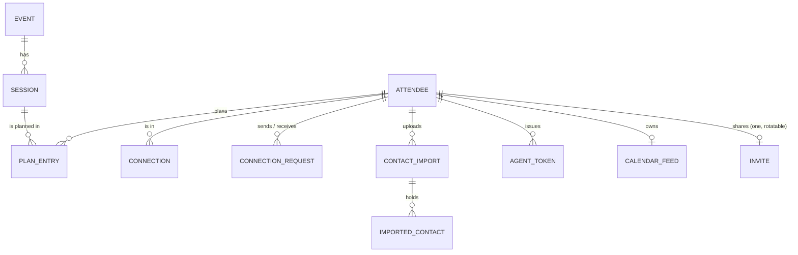
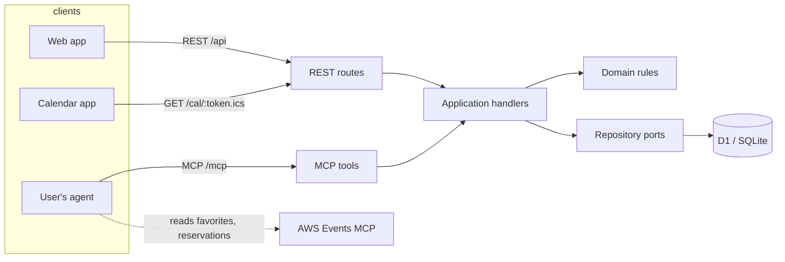

# Domain: Hallway

Hallway shows you where the people you know will be at AWS re:Invent 2026
(Las Vegas, 30 Nov to 4 Dec 2026), and lets your agent plan around them.

Written 2026-11-13, before any code, from the owner's brief and the research in
`docs/discovery/aws-events-api.md` and `docs/discovery/linkedin.md`. This file is
the model the code must match; when the code needs something different, change
this file in the same PR.

## What people need to do

1. **Get my re:Invent schedule in without retyping it.** My agent already talks
   to the AWS Events MCP server, which knows my favorites and reservations. I
   tell it "put my schedule on Hallway" and it does.
2. **See where my people will be.** Open a colleague's page and see their week;
   open a session and see which of my connections are going.
3. **Let my agent plan with my network.** "I'm free Tuesday afternoon, what are
   my connections going to?" "Find a gap where I can meet Priya."
4. **Show off my week.** Post a picture of my schedule on LinkedIn with a link
   that opens the live page, and subscribe to it in my calendar.
5. **Click through to the real thing.** Every session links to its page on the
   re:Invent site, where reserving happens. Hallway never reserves.
6. **Control who sees it.** Public, connections only, or private; hide any
   single session.

## Constraints the research fixed

- **We cannot read anyone's AWS schedule ourselves.** The AWS Events API's only
  OAuth client is public and accepts loopback callbacks on fixed ports, so a web
  app cannot sign people in to it. The attendee's own agent reads AWS and writes
  to us. That is the whole import path, and it is a feature: the agent is the
  user's, the token is the user's, we hold nothing of AWS's.
- **The catalog is behind registration**, so we cannot crawl it. Hallway's
  session catalog is the union of the sessions attendees' agents send, each a
  snapshot. We keep the fields needed to place and identify a session and
  **never store or show the abstract**: the abstract is AWS's content behind a
  login, and the link out is how people read it.
- **LinkedIn will not give us anyone's connections.** Sign In with LinkedIn
  (OpenID Connect) gives a verified identity: `sub`, name, picture, email. The
  Connections API is partner-only and closed. So the network is Hallway's own
  (connect requests), seeded from the user's LinkedIn data export
  (`Connections.csv`) and from share links.

## Resources

Each resource is what the REST API exposes and what the MCP tools speak. The
front end knows these shapes and nothing else.

| Resource | What it is | Key fields |
| --- | --- | --- |
| **Attendee** | A person on Hallway | `id`, `handle` (share URL `/@handle`; reserved words such as `api`, `settings`, `dev` are refused, `isReservedHandle`), `displayName`, `headline`, `avatarUrl`, `linkedinProfileUrl` (claimed, unverified), `visibility` (`public` \| `connections` \| `private`, default `connections`). Private: `linkedinSub`, `verifiedName` (LinkedIn's name, not editable), `email` (stored only when LinkedIn says it is verified, with its SHA-256 for suggestions) |
| **Event** | re:Invent 2026, as AWS describes it | `eventId` (`reinvent2026`), `name`, `timezone` (`America/Los_Angeles`), `startDate`, `endDate`. Seeded, not user-created |
| **Session** | A catalog snapshot of one session | `sessionId` (AWS's), `eventId`, `code` (AWS `abbreviation`, e.g. `AIM3315`), `title`, `type`, `level`, `venue`, `room`, `startsAt`/`endsAt` (UTC instants, derived from AWS's local date, time, length and the event timezone), `isAllDay`, `speakers[]` (names), `topics[]`, `url` (derived, see below), `lastSeenAt`. **No abstract** |
| **Plan entry** | One session on one attendee's schedule | `attendeeId`, `sessionId`, `intent` (`interested` = AWS favorite, `reserved` = AWS reservation), `source` (`agent-sync` \| `manual`), `hidden` (bool), `addedAt` |
| **Connection** | Two attendees who agreed to see each other | unordered pair, `since`, `via` (`request` \| `share-link`) |
| **Connection request** | One attendee asking another | `from`, `to`, `status` (`pending` \| `accepted` \| `declined` \| `withdrawn`), `createdAt` |
| **Contact import** | One upload of the user's LinkedIn `Connections.csv` | `id`, `attendeeId`, `importedAt`, `count` |
| **Imported contact** | One row of it, reduced | normalized LinkedIn profile URL, SHA-256 of a lowercased email when present, normalized full name. **No other columns are kept** (company, position and the raw email are dropped at parse) |
| **Suggestion** | Derived, not stored: an attendee who matches one of my imported contacts and is not yet connected | `attendee`, `reason` |
| **Agent token** | A personal token an agent uses for MCP and REST | `id`, `label`, `prefix` (shown), hash (stored), `createdAt`, `lastUsedAt`, `revokedAt`. Secret shown once |
| **Calendar feed** | A secret iCalendar URL of my visible schedule | `token` (rotatable; stored readable so its owner can see the link again, unlike every other secret; shown only to its owner signed in as a person, never in a public resource). One per attendee |
| **Invite** | The secret in my share link, `/@handle?invite=<token>`: whoever opens it may connect to me at once | `token` (32 random bytes, base64url; made on first ask, rotatable; stored readable like the calendar feed so its owner can copy the link again; shown only to its owner signed in as a person, never in a public resource or a log), `rotatedAt`. One per attendee |

### Session link

`url` is not stored: the contract resource derives it from `code` with `sessionUrl(code, template)` and one configured template,
`SESSION_URL_TEMPLATE`. The default is the re:Invent catalog searched for the
code. **Assumption** (no public deep-link format was found): the template is one
config value precisely so that it can change without a migration. See issue
"Confirm the session deep-link format".

### Times

AWS gives a session's local `date`, `time` and `length` in the event timezone.
We store UTC instants and the event timezone, and render in the event timezone
(Las Vegas time), always, because that is the time on the badge.

## Rules (the domain holds these)

- **Visibility.** Who may see an attendee's schedule:
  - `public`: anyone with the link, signed in or not.
  - `connections`: the attendee and their connections.
  - `private`: the attendee only.
  - A `hidden` plan entry is never shown to anyone but its owner, and never
    counted in "who is going".
  - One function decides this (`canViewSchedule(viewer, owner, areConnected)`, with `visibleEntries` for the entries), and every read path
    (REST, MCP, calendar feed, share image, link preview) goes through it.
- **Sync replaces, never duplicates.** `SyncSchedule` for an event makes the
  attendee's `agent-sync` entries exactly equal to the sent favorites and
  reservations: new ones added, missing ones removed, `reserved` beats
  `interested` when a session is in both. `manual` entries and every entry's
  `hidden` flag survive a sync. A sync never removes or lowers a `manual`
  entry, but raises it to `reserved` when the agent says it is reserved (I
  added it by hand, then reserved it on AWS); it keeps `source: manual`.
- **A listed id needs a session.** An id in `favorites` or `reserved` sent
  without a snapshot is kept when the catalog already has that session, and
  otherwise skipped and returned in `missingSessions`; it never fails the sync.
- **A sync is atomic.** The snapshots and the entry changes land together or
  not at all (ADR 0009).
- **Session snapshots merge forward.** A newer snapshot of a session replaces
  its fields; a field absent from the snapshot keeps its old value. A snapshot
  for an unknown event is refused.
- **A connection is mutual and needs consent.** A request becomes a connection
  only when the other side accepts. Connecting via someone's share link forms
  the connection at once: the link's current invite token is their consent
  (they shared it) and the click is yours. A bare `/@handle` is not consent
  and connects no one; without the current token the viewer can still send a
  request. Rotating the invite stops old links connecting and leaves existing
  connections alone. Decided in review of #38, after the first build connected
  anyone who knew a handle.
- **Suggestions need two matching facts.** A contact suggests an attendee when
  the profile URL matches **and** the contact's name matches the attendee's
  `verifiedName` (accents, case and spacing ignored, nothing fuzzier), or the email hash matches the attendee's verified email. A
  claimed URL alone suggests no one: anyone can claim any URL.
- **Agent tokens act as their attendee**, for that attendee's data and that
  attendee's view of others. Never more: an agent token may not issue, list
  or revoke agent tokens, nor rotate or read the calendar feed or the invite (`forbidden`),
  so a stolen token cannot outlive its own revocation (ADR 0008).

## Commands

| Command | Who | Effect |
| --- | --- | --- |
| `SignIn` | anyone | LinkedIn OIDC (or dev sign-in locally); creates the attendee on first sign-in, picking a free handle |
| `UpdateProfile` | me | handle, display name, headline, claimed LinkedIn URL |
| `SetVisibility` | me | `public` \| `connections` \| `private` |
| `SyncSchedule` | me, via agent | `{ eventId, sessions: Session snapshot[], favorites: id[], reserved: id[] }`; upserts the snapshots, then replaces `agent-sync` entries (rules above). Snapshots are AWS's `Session` shape as sent; the abstract is dropped unread. Returns counts `added`, `removed`, `changed` (intent), `unchanged`, `sessionsStored`, and `missingSessions` |
| `AddToPlan` / `RemoveFromPlan` | me | a manual entry (`interested`) for a session already in the catalog. Adding a session already on my plan returns that entry unchanged. Removing an `agent-sync` entry is refused (`conflict`): the next sync would bring it back, so hide it or drop it on AWS |
| `SetEntryHidden` | me | hide or show one entry |
| `IssueAgentToken` / `RevokeAgentToken` | me, signed in as a person (not an agent token) | |
| `RotateCalendarFeed` | me, signed in as a person (not an agent token) | |
| `ImportContacts` | me | parse a `Connections.csv`, keep the reduced rows (exact duplicates folded), replace my previous import, all or nothing (ADR 0011) |
| `RequestConnection` / `WithdrawRequest` | me | |
| `AcceptRequest` / `DeclineRequest` | the recipient | |
| `ConnectViaShareLink` | signed-in viewer of `/@handle?invite=<token>` | with the owner's current invite token, connection formed at once (rule above); otherwise `forbidden`. Connecting to yourself is refused |
| `RotateInvite` | me, signed in as a person (not an agent token) | a new invite token; old links stop connecting, connections stay |
| `RemoveConnection` | either side | |

## Queries

| Query | Returns |
| --- | --- |
| `GetMe` | my attendee, with private fields |
| `GetCalendarFeed` | my current feed URL, to me signed in as a person (not an agent token) |
| `GetInvite` | my share link with its invite token, made on first ask, to me signed in as a person (not an agent token) |
| `GetMySchedule(eventId)` | my entries with sessions, hidden ones included and marked, in start order, with the event's timezone to render them in |
| `GetAttendee(handle)` | the attendee's public card, and whether I may see the schedule |
| `GetAttendeeSchedule(handle, eventId)` | their visible entries, or "not visible to you" (`forbidden`). Only the owner sees hidden entries, marked |
| `ListConnections` / `ListRequests` / `ListSuggestions` | my connections; my pending requests, incoming and outgoing; attendees my imported contacts suggest, leaving out me, my connections and anyone a request is pending with either way |
| `SearchSessions(eventId, q?, day?, from?, to?)` | catalog sessions, with how many of my connections are going. Built so far: `q` (code, title or speaker, ignoring case), `day` (an event-local date; sessions starting on it) and `limit`; open to any caller, since sessions are facts about the event. To a signed-in caller each session carries `connectionsGoing` (count, and up to five people), from one read for the whole page. `from` and `to` are not built: `NetworkAgenda` answers windows |
| `GetSession(eventId, sessionId)` | the session, and to a signed-in caller `connectionsGoing` as in search |
| `WhoIsGoing(eventId, sessionIds[])` | per session, my connections going (respecting visibility and hidden), up to 200 sessions in one read |
| `NetworkAgenda(eventId, day, from?, to?)` | sessions starting in a window of one event-local day (`from`/`to` as `HH:MM`, default the whole day) that my connections plan to attend, with who |
| `FindMeetingGaps(handle, day, from?, to?, minMinutes?)` | windows on a day, in event time (default 08:00 to 18:00, at least 30 minutes), when neither I (every entry, hidden ones too) nor that person (their visible entries) has a session; refused when their schedule is not visible to me. All-day sessions (the expo and the like) do not block a gap |
| `ExportCalendar(feedToken)` | iCalendar of the owner's visible, non-hidden schedule |
| `ShareImage(handle, day?)` | a PNG of the visible schedule, for posting |

## Who calls what

REST routes and MCP tools are two interfaces over the **same handlers**; neither
holds logic the other lacks. Both take and return the contract schemas in
`packages/contracts`.

### MCP tools (Hallway's own server, at `/mcp`)

| Tool | Handler |
| --- | --- |
| `sync_my_schedule` | `SyncSchedule`. Its description tells the agent how to get the input from the AWS Events MCP (`GetSchedule`, then `GetSession` per id) |
| `get_my_schedule` | `GetMySchedule` |
| `list_my_connections` | `ListConnections` |
| `get_person_schedule` | `GetAttendeeSchedule` |
| `who_is_going` | `WhoIsGoing` |
| `network_agenda` | `NetworkAgenda` |
| `find_meeting_gaps` | `FindMeetingGaps` |
| `search_sessions` | `SearchSessions` |
| `add_to_plan` / `remove_from_plan` | `AddToPlan` / `RemoveFromPlan` |

## Out of scope for the MVP

Reserving on AWS (the user's agent does that against AWS directly), personal
time blocks, messaging, events other than re:Invent 2026, deployment, OAuth for
the MCP server (agent tokens first), notifications.
